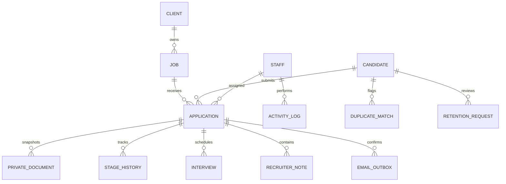

# ATS data model and persistence contract

The owner selected existing InMotion cPanel hosting with MariaDB. The isolated `sankhala_ats` database is created but empty. This logical model has not been applied as migrations and deliberately does not access an unrelated database.

## Core records

- Candidate: immutable unique ID, canonical contact/profile fields, created/updated dates, optional merged-into ID, talent-pool status and review/deletion dates. Canonical edits are versioned/audited.
- Client: ID, name and status. Internal vacancies use employer kind `sankhala`; client vacancies require a stored client ID.
- Job: unique ID/reference, owner/client, category, all approved posting fields, publication state, employer confirmation actor/time, closing timestamp and recruiter/hiring-manager assignments. No fixtures in the live job feed.
- Application: unique ID/reference, candidate ID, nullable job ID for general CV, immutable candidate/job/client/category snapshots, consent version/time, request idempotency key/hash, stage, assigned recruiter and read/review timestamps.
- Private document: unique ID, application ID, random private storage key, original name, verified MIME/size/hash, scan result and deletion state. No public URLs. A new application/document version never overwrites the old one.
- Interview: application, assigned staff, start/end with timezone, location/link, notes and status. Export/access remain scoped to authorized staff.
- Stage history, notes and activity log: application/candidate, actor, event, timestamp and sanitized metadata. Include view, download, export, assignment, status, merge and retention actions. Logs do not duplicate full CV contents or sensitive form fields.
- Email outbox: application, recipient kind, unique delivery key, template payload, attempt count, next retry, delivery status and last sanitized error.
- Duplicate match: two candidate IDs, email/phone evidence and HR review resolution. The public submitter cannot inspect existing candidates or force a merge by supplying someone else's email.
- Retention request: candidate/application scope, request verification, due date, legal/recruitment hold, approval and deletion progress. Database and object storage deletion must be coordinated and auditable.

## Submission transaction

Validate the allowed form fields server-side. Resolve and lock the stored job, reject closed/unconfirmed/unpublished jobs, derive category/client/job snapshots from it, check rate/idempotency controls and validate/scan private uploads. The database transaction creates the candidate/submission snapshot, application, document metadata, initial New history and notification outbox entries. Return success only after commit. Compensate staged object uploads on failure and reconcile orphan cleanup; retrying the same idempotency key must not create another application or duplicate email.

Email/phone matches create reviewable duplicate flags. HR-confirmed linking produces one canonical candidate with multiple application histories; snapshots and previous profile versions are retained. Automatic profile overwrite or unverified identity merging is prohibited.

## Access and operations

Admin manages all records, staff, publication and retention. Recruiters operate on their assigned scope; hiring managers see only assigned jobs/applicants and permitted fields/actions. Scope must be checked in server queries and every document/export endpoint, not only hidden in the UI. No public candidate-list or document access.

Backups must cover both database and private objects with encryption, access control, a schedule, retention and a tested restore. Email transport, object storage and existing hosting credentials remain configuration prerequisites; none is silently assumed to be working.
